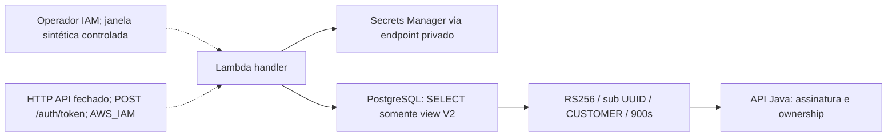

# Oficina — autenticação Lambda, Fase 3

**Grupo 97** · **Pedro Paulo dos Santos Silva** · Discord **pedropaulo6447**.
Emissor CUSTOMER Python 3.13 x86_64, handler `auth.handler.lambda_handler`,
PostgreSQL/psycopg e JWT RS256. Infraestrutura auth em Terraform 1.14.6/provider AWS
6.38.0. [Entrega consolidada](https://github.com/ppdssdev/tech-challenge-oficina/blob/main/docs/fase3/README.md) · [evidências deste repo](docs/fase3-evidence.md).

## Estado e arquitetura

Auditoria 2026-11-03: Lambda Active, mas **concorrência reservada zero**; HTTP API
endpoint desabilitado e rota AWS_IAM. Não há endpoint público funcional nem produção
comprovada. CI main aprovado não comprova artefato implantado ou autenticação E2E.
CPF sozinho não prova identidade; uso restrito à demonstração com UUIDs sintéticos.



Setas descrevem o contrato; invocação está bloqueada na configuração observada.
[Contrato staging](docs/infra-staging.md), [ADR Lambda](docs/adr/0001-lambda-auth.md)
e [sequência completa](https://github.com/ppdssdev/tech-challenge-oficina/blob/main/docs/fase3/sequences.md).

## Contratos e segurança

`POST /auth/token`: JSON com somente campo `cpf`, canônico, 11 dígitos ASCII com
verificadores válidos; limite 1 KiB. Rejeita campos extras, JSON duplicado, CPF
formatado ou em query. Contratos: [request](contracts/request.schema.json),
[response](contracts/response.schema.json), [error](contracts/error.schema.json).
Não há Swagger próprio; schemas e handler payload 2.0 são o contrato versionado.

200: access_token, token_type Bearer, expires_in 900. JWT RSA >=2048 bits, RS256,
kid, iss/aud, sub UUID, role CUSTOMER, iat=nbf, exp=iat+900; sem CPF nos claims.
400 INVALID_REQUEST; 401 AUTHENTICATION_FAILED uniforme; 503 TEMPORARILY_UNAVAILABLE.
Respostas no-store; não registrar CPF, token ou detalhes das dependências.

[Adapter SQL](auth/postgres.py) usa parâmetro, LIMIT 2, read-only e timeouts.
Consulta **somente auth.customer_identity_v2**. V11 publica habilitação explícita
em auth.customer_access; ausência equivale a false e colisões normalizadas são
excluídas. customers.active é atividade de negócio independente; não revoga emissão
V2. Sem fallback V1. Cloud exige também UUID na allowlist sintética.

[Adapter cloud](auth/cloud.py): TLS verify-full, CA confiável, oficina_lambda e
segredo composto com username/password/private_key_pem/ca_pem/kid. Nunca publicar
valores. Chave privada fica com o emissor; API recebe somente chave pública.
A fixture [JWKS](contracts/jwks.public.json) não é chave operacional.

## Execução e testes

```bash
python3.13 -m venv .venv
. .venv/bin/activate
pip install -r requirements-dev.txt
ruff check auth scripts tests
python -m pytest -q -ra
```

Sem TEST_DATABASE_URL, os testes PostgreSQL/TLS são ignorados: resultado parcial não
é aceite. Para validação integral, usar Linux, Docker local, Python 3.13 e Terraform
1.14.6, com clone Java irmão e histórico suficiente:

```bash
bash scripts/validate_external.sh ../tech-challenge-oficina
```

O comando cria banco PostgreSQL 16 **descartável local**, aplica SQL/grants reais
V1–V11, exige zero skips, executa Ruff, Terraform validate/11 cenários mock e smoke
ZIP. Nunca apontar testes para RDS ou banco compartilhado. Pin Java no
[JAVA_CONTRACT_SHA](JAVA_CONTRACT_SHA), fixado em
`57eb5df2c3e32fe5663596cbecfcd43a5d3ed780`; nenhuma cópia de migrations Python.
Pré-requisitos/resultados históricos: [validação externa](docs/fase3/lambda-v2-final.md).

Execução manual local requer APP_ENV=local, JWT_ISSUER, JWT_AUDIENCE, JWT_KID,
JWT_PRIVATE_KEY_FILE e DATABASE_URL. Gerar chaves de teste fora do repo; não usar
segredo cloud. O runtime staging usa AUTH_SECRET_ARN e configuração do Terraform.

## Build, CI/CD e deployment

`python scripts/build.py <sha-completo>` gera ZIP/checksum em dist, com wheels e
hashes em [lock de runtime](requirements-runtime.lock). Build determinístico,
inspeção por `scripts/validate_zip.py` e smoke em imagem Lambda por digest sem rede.
[CI](.github/workflows/ci.yml) chama a validação integral e publica artefato de teste.
Não há CD AWS em main. [PR OIDC #5](https://github.com/ppdssdev/tech-challenge-oficina-auth-lambda/pull/5)
é preparatória e estava aberta; SCP bloqueia auditoria provider.

[Terraform](infra/terraform/main.tf) declara code signing Enforce; build local não
é ZIP assinado. Deployment exige revisão do ZIP final assinado, contratos reais
K3s/RDS, segredo/JWKS/grants/TLS e aceite E2E; seguir [runbook](docs/infra-staging.md).
Janela sintética permite concorrência 2 quando autorizada, mas não abre endpoint HTTP.
Não há Function URL declarada. Esta PR não ativa nem invoca a função.

Backend S3 com chave staging/lambda e lockfile é definido em
[backend.tf](infra/terraform/backend.tf); migração/hardening operacional constam em
[MIGRACAO-BACKEND.md](MIGRACAO-BACKEND.md). Não compartilhar state/secret values.
Para validação estática: `terraform -chdir=infra/terraform init -backend=false` e
`terraform -chdir=infra/terraform validate`; não executar apply para revisar docs.

## Integração e limites

[API e migrations](https://github.com/ppdssdev/tech-challenge-oficina) ·
[Rede/K3s](https://github.com/ppdssdev/tech-challenge-oficina-infra-k3s) ·
[RDS](https://github.com/ppdssdev/tech-challenge-oficina-infra-rds).
Relatórios de prompts são históricos e não certificam estado atual. Pendentes:
proveniência do artefato cloud, assinatura, grants/TLS, janela sintética E2E,
rotação, OIDC/CD e autenticação adequada antes de qualquer uso real.
