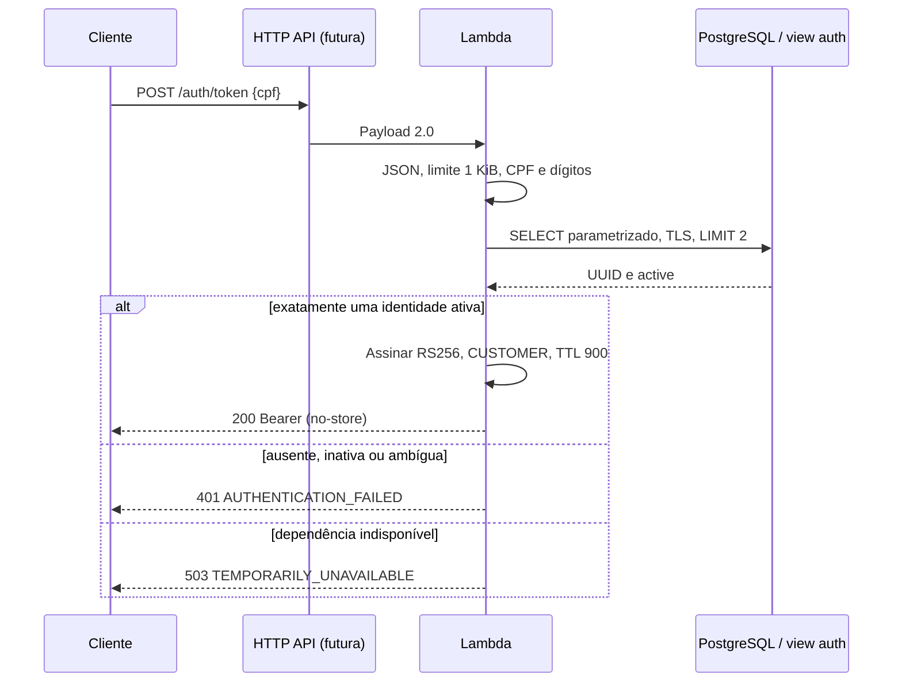

# Oficina — Lambda CPF/JWT (Fase 3, Prompt 04)

Emissor executável Python 3.13, handler `auth.handler.lambda_handler`, arquitetura
x86_64, API Gateway HTTP API payload 2.0. Sem deploy, CD ou recursos AWS nesta PR.
**Spring Boot ainda usa HMAC e não aceita estes tokens RS256.** Não liberar integração
cloud até a migração e os testes de RBAC descritos abaixo.

## Contrato e fluxo



Exemplo exclusivamente sintético (não representa cliente cadastrado):

```http
POST /auth/token
Content-Type: application/json

{"cpf":"52998224725"}
```

Resposta quando houver exatamente um cliente ativo correspondente:
`{"access_token":"<JWT RS256>","token_type":"Bearer","expires_in":900}`.
Headers em todas as respostas: `Content-Type: application/json`, `Cache-Control: no-store`.
400 `{"code":"INVALID_REQUEST"}` para evento, rota/método, content-type, CPF ou JSON
inválidos. 401 igual para ausente/inativo/ambíguo. 503 sem detalhe interno para falhas
SQL/configuração/chave/assinatura. 429 pertence ao futuro throttling do gateway.
Não aceitar CPF em query string, CPF formatado, campos extras ou chaves JSON duplicadas.
Body base64 validado e limite aplicado aos bytes decodificados. Nenhum dado de evento
ou exceção é logado; o único log do handler é categoria fixa de falha.

## Estrutura

- `auth/handler.py`: composição e tradução HTTP; `request.py`: parsing e CPF.
- `auth/service.py`, `ports.py`: política e portas de identidade, assinatura e chave.
- `auth/postgres.py`: SELECT parametrizado e fechamento garantido da conexão.
- `auth/jwt.py`: chave RSA >=2048 bits, RS256 fixo, claims mínimas sem CPF.
- `auth/config.py`: configuração obrigatória e requisitos TLS cloud.
- `contracts/`: schemas originais e fixture **somente pública** `jwks.public.json`.
- `tests/`: contrato, unidade/criptografia e integração PostgreSQL real.
- `scripts/`: build, inspeção ZIP, smoke Linux e preparação do banco de testes.

## Configuração e execução local

Variáveis obrigatórias: `APP_ENV=local|staging|production`, `JWT_ISSUER`,
`JWT_AUDIENCE`, `JWT_KID`, `JWT_PRIVATE_KEY_FILE`, `DATABASE_URL` (conninfo libpq).
Issuer/audience devem ser exclusivos por ambiente; audience `oficina-api-<environment>`.
TTL fixo 900, sem override de algoritmo. Kid aceita letras/dígitos/ponto/hífen/underscore.
Ausência/configuração inválida impede emissão. Composição é lazy e só guarda serviço
após sucesso; falhas retornam 503 e não são expostas como stacktrace.

Cloud exige issuer HTTPS, host único, `sslmode=verify-full` e arquivo CA confiável via
`sslrootcert`. Mesmo APP_ENV=local não dispensa TLS se executado em Lambda. O caminho
para CA não garante cadeia válida: a validação criptográfica ocorre no handshake libpq.
Instalar CA oficial RDS e configurar hostname exato na etapa AWS. Banco com credencial
exclusiva read-only, conexão de 2 s e statement_timeout de 2 s; uma conexão por invocação,
fechada no retorno/erro, transação read-only. Reservar 5 s de timeout na infraestrutura;
limite global de conexões depende de reserved concurrency, ainda não provisionada.

```sh
python3.13 -m venv .venv
. .venv/bin/activate
pip install -r requirements-dev.txt
ruff check auth scripts tests
python -m pytest -q
```

Sem TEST_DATABASE_URL, três testes de integração são explicitamente skipped; CI exige
PostgreSQL. Em banco **descartável vazio**, definir TEST_DATABASE_URL (não credenciais AWS)
e executar `python scripts/prepare_integration.py /caminho/app` para aplicar SQL real
V1–V10 e grants do produtor, seguido de `python -m pytest -q`. Nunca executar esse script
em banco real. Flyway real e upgrade V9→V10 são testados na PR da aplicação.
CI fixa o commit da PR produtora, permitindo revisão independente sem duplicar migration.

Testes geram chaves descartáveis em memória. Para invocação manual local, gerar chave
temporária fora do checkout, apontar JWT_PRIVATE_KEY_FILE e apagar após uso. Nunca
commitar privada, .env preenchido ou credenciais. `PrivateKeyProvider` prepara adapter
Secrets Manager futuro; nesta PR só existe provider de arquivo. Não há acesso AWS.

## Build e evidência

`python scripts/build.py "$(git rev-parse HEAD)"` produz
`dist/auth-lambda-python313-x86_64-<sha>.zip` e checksum, substituindo o bundle só de
contratos. Wheels completos fixados por versão/hash em requirements-runtime.lock,
CPython 3.13 manylinux2014 x86_64, sem bytecode e timestamps ZIP fixos. O CI compara
builds repetidos, inspeciona layout/segredos e executa o ZIP extraído em imagem oficial
Lambda Python 3.13 fixada por digest, sem rede. Dependências de desenvolvimento não
entram no pacote. Atualizar pins/hashes deliberadamente após revisão de segurança.
A inspeção detecta PEM privado, nomes secretos comuns e padrões de access key; não é
prova absoluta de ausência de todo segredo possível. O build só inclui código auth e wheels.

Em PR, GITHUB_SHA é merge sintético, diferente do HEAD da PR. Artifact é evidência de
CI, não release implantada. Não há CD. [Empacotamento AWS](https://docs.aws.amazon.com/lambda/latest/dg/python-package.html)
e [runtime Python 3.13](https://aws.amazon.com/blogs/compute/python-3-13-runtime-now-available-in-aws-lambda/).

## Integração futura e riscos

CPF isolado não prova identidade e permite impersonação por quem o conhece. Requisito
acadêmico apenas; produção real exige fator adicional. Mensagens uniformes reduzem
enumeração, mas não eliminam diferenças temporais ou tentativas online. Configurar
rate limiting API Gateway, reserved concurrency, alarmes e logs sem corpo/Authorization.
Inativação bloqueia novos tokens; token emitido pode durar 15 min. Revogação imediata
exige estratégia própria. Não há conectividade implícita do handler local com RDS.

Publicar somente JWKS público HTTPS por ambiente. Fixture versionada tem privada
DESCARTADA e kid `public-fixture-only`: serve para parsing do consumidor, não para
produção ou tokens fixos. Testes criptográficos geram suas próprias chaves. Rotação:
publicar nova pública, esperar propagação/cache, trocar privada+kid no emissor, manter
pública anterior por 900 s + skew <=60 s + cache máximo, depois retirar. Planejar cache
limitado/invalidação do provider e validadores; rotação automática não implementada.

Spring deve verificar exclusivamente RS256 no fluxo CUSTOMER, assinatura, kid confiável,
iss/aud, exp/nbf/iat, UUID sub e role singular CUSTOMER. Mapear principal de cliente sem
carregar usuário administrativo por username; provar negação ADMIN e acesso somente aos
recursos próprios. Preservar login HMAC ADMIN até migração explicitamente testada, sem
aceitação indiscriminada HS/RS. Exigir testes de chave desconhecida, rotação, claims
erradas, token expirado, algoritmo none/HMAC e falha de JWKS. Integração completa é próximo prompt.

AWS futuro: VPC/subnets privadas, SG auth→RDS:5432, CA confiável, Secrets Manager por
endpoint privado e IAM mínimo, segredo privado/credencial read-only por ambiente,
publicação JWKS e configuração de gateway/timeouts/concurrency. Nada disso foi criado.
