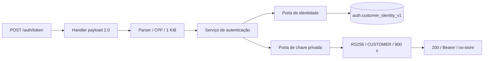

# Entrega consolidada — Prompt 04

- [PR A — Lambda #2](https://github.com/ppdssdev/tech-challenge-oficina-auth-lambda/pull/2)
- [PR B — aplicação #4](https://github.com/ppdssdev/tech-challenge-oficina/pull/4)
- Branches: `feature/fase3-cpf-jwt-runtime` e `feature/fase3-auth-identity-view`.
- Implementação auth: `3a66d36b60b38124ddfe2fdec6ccb3f72441edab` (este relatório é posterior).
- Produtor SQL fixado pelo CI: `4311ab9ef2a0ec3cf33cdc1fb28d68ca66b403bb`.

## Resultado e evidências locais

| Validação | Resultado |
|---|---|
| Ruff, auth/scripts/tests | Aprovado |
| Pytest Python 3.13 na imagem oficial Lambda, PostgreSQL 16 real | **53 passaram**, sem skips |
| Pytest Python 3.12 auxiliar | **53 passaram**, sem skips |
| Aplicação `mvn -B verify` | **138 testes**, zero falhas/erros/skips; JaCoCo aprovado |
| ZIP executável em Lambda Python 3.13 Linux x86_64 | Imports nativos, handler e assinatura RS256 verificados, sem rede |
| Build repetido | Checksum SHA-256 idêntico |
| Inspeção ZIP | Layout e varredura de segredos aprovados |

Os testes de integração aplicaram SQL real V1–V10 em PostgreSQL descartável, sem mock
do adapter. O teste de upgrade usa Flyway real sobre V9 com dados preexistentes.
`test_real_readonly_login_and_handler` conecta com LOGIN que herda somente a role
read-only, invoca o handler e verifica o token com a pública da chave descartável;
inativação e exclusão retornam 401. Outros testes provam recusa de CPF normalizado
ambíguo, consulta parametrizada resistente a string SQL, acesso negado a tabelas,
escrita e DDL, e falha real de conexão. Não há credenciais AWS em testes.

`test_valid_token` valida assinatura RSA, algoritmo RS256, issuer, audience, UUID sub,
role CUSTOMER, kid e exp−iat=900; chave pública incorreta e algoritmo HMAC falham.
Testes adicionais verificam expiração, tempo futuro, configuração/chaves inválidas e
logs sem dados sensíveis. Fixture pública JWKS parseável é versionada, sem privada.

Imagem usada no smoke: `public.ecr.aws/lambda/python@sha256:cf3e082b6c28721944dfef2c252c2e6df2f65aab3c2e2a64ce1f86f80c7aa13d`.
Mensagem de evidência: `Python 3.13 Linux: handler imported, native dependencies loaded, RS256 verified`.
Não é evidência de invocação AWS ou integração Spring. Resultados remotos e artifacts
estão nos checks das PRs; GITHUB_SHA de PR representa merge sintético, não HEAD nem deploy.

## Fluxo, arquivos e exemplos

Estrutura e instruções completas no [README](../README.md). Arquivos principais:
`auth/{handler,request,service,ports,postgres,jwt,config,errors}.py`, `tests/`,
`contracts/jwks.public.json`, `scripts/{build,validate_zip,smoke_bundle}.py` e
`.github/workflows/ci.yml`. No produtor: `V10__customer_identity_view.sql`,
`CustomerIdentityViewIntegrationTest.java`, `scripts/provision-auth-readonly.sql`,
`docs/fase3/auth-identity-view.md`. Nenhuma migration V1–V9 foi alterada.

Exemplo sintético: `POST /auth/token`, `Content-Type: application/json`,
`{"cpf":"52998224725"}`. Se o banco contiver exatamente uma identidade ativa:
`{"access_token":"<JWT RS256>","token_type":"Bearer","expires_in":900}`.
Caso contrário, `401 {"code":"AUTHENTICATION_FAILED"}`; entrada inválida recebe 400;
falha interna/dependência recebe 503. Headers JSON e `Cache-Control: no-store`.

## Limites e próximo passo

CPF sozinho permite impersonação; adicionar fator de posse em produção. Mensagens
uniformes não eliminam enumeração temporal. Inativação não revoga tokens já emitidos.
Rate limiting, reserved concurrency, métricas e proteção do gateway ainda dependem
na etapa AWS de infraestrutura, conectividade privada, SGs, CA RDS, Secrets Manager
com endpoint privado/IAM mínimo e distribuição JWKS. Provider Secrets Manager e
rotação automática não implementados; interface e procedimento estão documentados.

A aplicação permanece HMAC, com login ADMIN preservado. **Não aceita os JWTs RS256
emitidos aqui.** Próximo passo recomendado após revisão técnica: implementar e testar
Spring Security/JWKS/claims/principal UUID, negar CUSTOMER em rotas ADMIN e garantir
isolamento de clientes; migrar ADMIN explicitamente sem confiança indiscriminada
HS/RS, testar rotação e falha fechada. Só depois habilitar integração cloud em tarefa
separada autorizada. Não houve deploy, recursos AWS, Terraform apply/destroy,
alterações K3s/RDS, merge automático ou redução de proteções.
